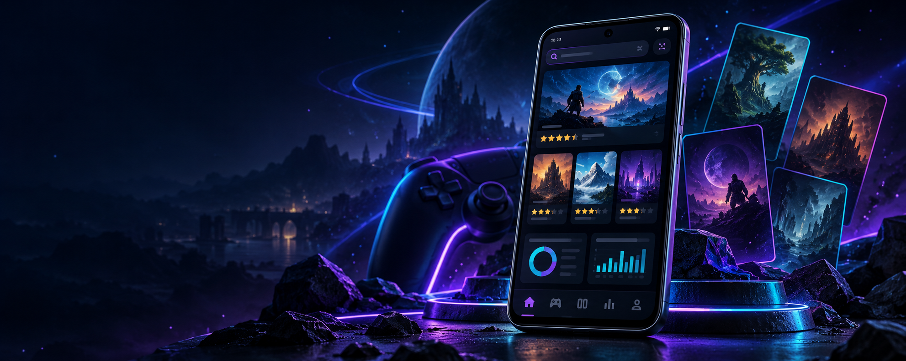
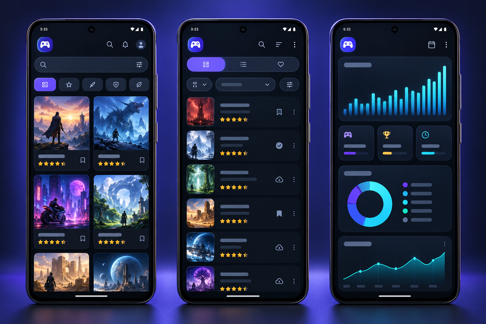
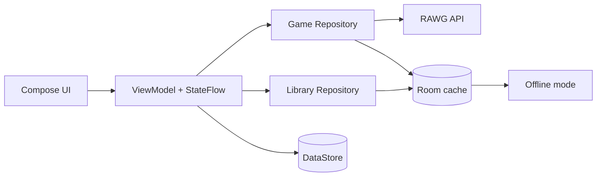

<div align="center">



# GameDex

### Discover. Track. Rate. Play.

Нативный Android-каталог видеоигр с персональной библиотекой, половинчатыми оценками, умным поиском, аналитикой и полноценным офлайн-режимом.

[](https://developer.android.com/about/versions/12)
[](https://kotlinlang.org/)
[](https://developer.android.com/compose)
[](https://github.com/Sergo379/psiahramenco3_4/releases/latest)
[](https://github.com/Sergo379/psiahramenco3_4/actions/workflows/android-ci.yml)

[Скачать APK](https://github.com/Sergo379/psiahramenco3_4/releases/download/v1.1.0/GameDex-Android12-v1.1.0.apk) · [Открыть релиз](https://github.com/Sergo379/psiahramenco3_4/releases/tag/v1.1.0) · [Прочитать отчёт](REPORT.md)

</div>

---

## Что такое GameDex

GameDex объединяет каталог RAWG и личный игровой трекер в одном приложении. Можно находить игры, изучать подробные карточки, собирать библиотеку, назначать статус прохождения и ставить собственную оценку — даже без подключения к интернету после загрузки данных.

| Открывайте | Сохраняйте | Оценивайте | Анализируйте |
|:--:|:--:|:--:|:--:|
| Поиск, фильтры и рекомендации | Избранное и статусы прохождения | От 0,5 до 5 с точными полузвёздами | Динамика релизов за 7 и 30 дней |

## Визуальный обзор

<div align="center">
  
  <sub>Концепт-визуал основных сценариев: каталог, личная библиотека и аналитика.</sub>
</div>

## Возможности

### 🎮 Каталог и поиск

- реальные данные из RAWG API;
- relevance-first поиск с debounce и отменой устаревших запросов;
- фильтры по жанру, платформе и году;
- пагинация, игры серии, дополнения и издания;
- карточки с обложкой, рейтингом RAWG, Metacritic и подробной информацией.

### ⭐ Персональные оценки

- шкала от **0,5 до 5,0** с шагом 0,5;
- пять интерактивных Canvas-звёзд с точным заполнением половины;
- мгновенное сохранение, изменение и удаление оценки;
- независимость пользовательской оценки от рейтинга RAWG;
- accessibility semantics и отдельные действия для экранного диктора.

### 📚 Личная библиотека

- избранное и статусы «Хочу пройти», «Прохожу», «Пройдено»;
- оценённая игра попадает в библиотеку даже без статуса или избранного;
- локальный поиск и совместная фильтрация по статусу;
- сортировка по дате добавления, алфавиту и оценке в обе стороны;
- игры без оценки всегда остаются в конце рейтинговой сортировки.

### 📊 Аналитика и офлайн

- отдельные периоды за 7 и 30 завершённых дней;
- интерактивный Canvas-график, min/max/average/delta/percentage/trend;
- Room-кэш каталога и аналитики;
- DataStore для настроек и выбранной сортировки;
- дисковый кэш изображений Coil;
- понятные состояния ошибок, кэша и отсутствия сети.

## Как выглядит персональная оценка

```text
Оценка RAWG: ★ 4,4 / 5       ← данные внешнего сервиса
Моя оценка:  ★★★★½ 4,5 / 5  ← локальная оценка пользователя
```

Каждая звезда разделена на две крупные интерактивные области. Левая половина выбирает `0,5`, правая — целую звезду. Значение хранится в Room как целое число `1..10`, поэтому округление не теряется.

## Технологии

| Слой | Решение |
|---|---|
| UI | Jetpack Compose, Material 3, Navigation Compose |
| Архитектура | MVVM, Repository, immutable UI state |
| Асинхронность | Kotlin Coroutines, Flow, StateFlow |
| Сеть | Retrofit, OkHttp, Kotlin Serialization, RAWG API |
| Хранилище | Room, DataStore, Coil disk cache |
| Проверки | JUnit, Coroutines Test, Room MigrationTestHelper, Compose UI Test |
| Сборка | Gradle Kotlin DSL, JDK 17, GitHub Actions |



## Быстрый старт

### Готовый APK

1. Откройте [релиз GameDex v1.1.0](https://github.com/Sergo379/psiahramenco3_4/releases/tag/v1.1.0).
2. Скачайте `GameDex-Android12-v1.1.0.apk`.
3. Разрешите установку неизвестных приложений для браузера или файлового менеджера.
4. Установите APK и введите личный RAWG API-ключ на первом экране.

> [!WARNING]
> GitHub APK v1.0.1 и v1.1.0 подписаны разными временными debug-ключами. v1.1.0 нельзя установить поверх опубликованной v1.0.1. Удаление старой версии удалит её локальные данные. Для будущих публичных update-in-place сборок необходим единый защищённый release-key.

### Сборка из исходников

Требования: Android Studio, JDK 17, Android SDK 35 и устройство/эмулятор с Android 12+.

```powershell
git clone https://github.com/Sergo379/psiahramenco3_4.git
cd psiahramenco3_4
gradlew.bat clean testDebugUnitTest assembleDebug
```

Linux/macOS:

```bash
git clone https://github.com/Sergo379/psiahramenco3_4.git
cd psiahramenco3_4
./gradlew clean testDebugUnitTest assembleDebug
```

Результат: `app/build/outputs/apk/debug/app-debug.apk`.

## RAWG API

Источник данных — [RAWG Video Games Database](https://rawg.io/apidocs). Ключ не хранится в репозитории и не выводится в лог. Получите бесплатный ключ RAWG и введите его на стартовом экране приложения.

Для локальной сборки ключ также можно задать в непубликуемом `~/.gradle/gradle.properties`:

```properties
RAWG_API_KEY=ваш_ключ
```

## Room и сохранность данных

Версия 1.1.0 использует явную миграцию Room `1 → 2` без `fallbackToDestructiveMigration`.

- сохраняются избранное, статусы прохождения и аналитика;
- добавлены `userRatingHalfStars` и `addedAt`;
- локальные поля сохраняются при повторной загрузке игры из RAWG;
- изменение принадлежности к библиотеке и `addedAt` выполняется атомарно;
- для старых записей `cachedAt` используется только как приблизительный порядок, а не как точная дата добавления.

Миграция выполняется только при установке APK с совместимой подписью.

## Проверки качества


- 73 unit-теста проходят в GitHub Actions;
- debug APK и instrumentation APK собираются на JDK 17;
- добавлены 4 Room/Compose instrumentation-теста;
- migration-тест использует сохранённую реальную схему базы v1;
- запуск instrumentation-тестов на физическом устройстве не заявляется.

## Структура проекта

```text
app/src/main/java/com/sergo379/gamedex/
├── data/
│   ├── local/       Room, DataStore, cache
│   └── remote/      RAWG API и DTO
├── domain/          модели и чистая логика
└── ui/
    ├── components/  переиспользуемые Compose-компоненты
    ├── screens/     экраны приложения
    └── theme/       Premium Dark UI
```

## Ограничения

- первый сетевой запуск требует персонального RAWG API-ключа;
- полнота данных и изображений зависит от RAWG;
- без ранее заполненного кэша сетевые разделы не смогут показать данные офлайн;
- физическая проверка на Samsung Galaxy M31s остаётся отдельным ручным шагом;
- опубликованные debug APK v1.0.1 и v1.1.0 несовместимы для update-in-place.

> [!NOTE]
> Перед сдачей лабораторной студенту необходимо подтвердить преподавателю тему/показатель и то, что в лабораторной №3 не использовался Kotlin.

---

<div align="center">

**GameDex** · Kotlin · Compose · Room · RAWG

[Последний релиз](https://github.com/Sergo379/psiahramenco3_4/releases/latest) · [Отчёт](REPORT.md) · [RAWG API](https://rawg.io/apidocs)

</div>
